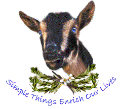

# Editor Melinda / Goat Mountain View

Copyediting and Nigerian Dwarf Goats in Washington.

## Prerequisites

- Python 3.14

## Installation

1. Clone the repository: `git clone https://github.com/pianosuki/goatmountainview.com.git`
2. Navigate to the project directory: `cd goatmountainview.com`
3. Create a virtual environment: `python3 -m venv venv`
4. Activate the virtual environment: `source venv/bin/activate`
5. Install the dependencies: `pip install -r requirements.txt`

## Configuration

1. Create the file `.env` and set the following variables:
   - `SECRET_KEY=<your-secret-key>`
   - `USERNAME=<your-username>`
   - `PASSWORD=<your-password>`
   - `SITE_URL=https://goatmountainview.com` (optional; this is the default preferred origin)
2. Run the setup function to generate the database: `python main.py`

## Running the project

1. Run with python for development:
- `python main.py`
2. Run with your WSGI HTTP server of choice
- `gunicorn main:app`

See [SEO maintenance and deployment](docs/seo.md) for metadata, image descriptions, and checks.
